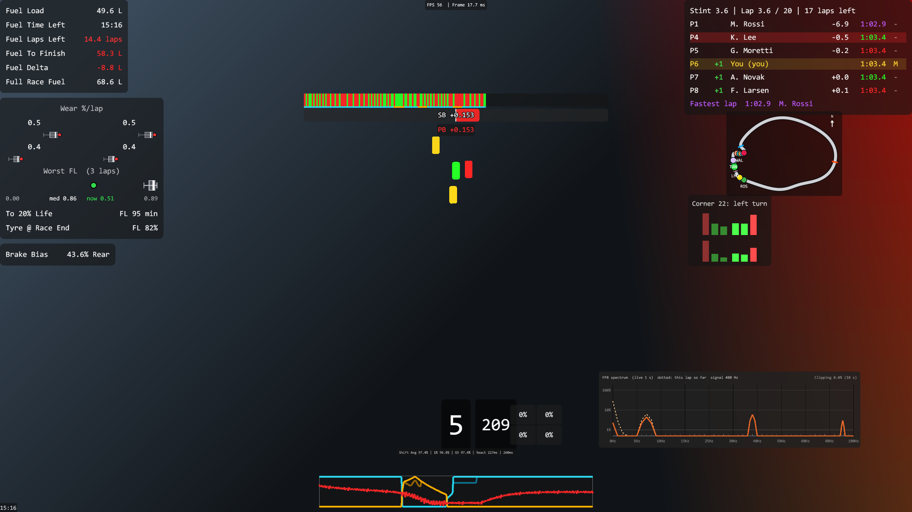
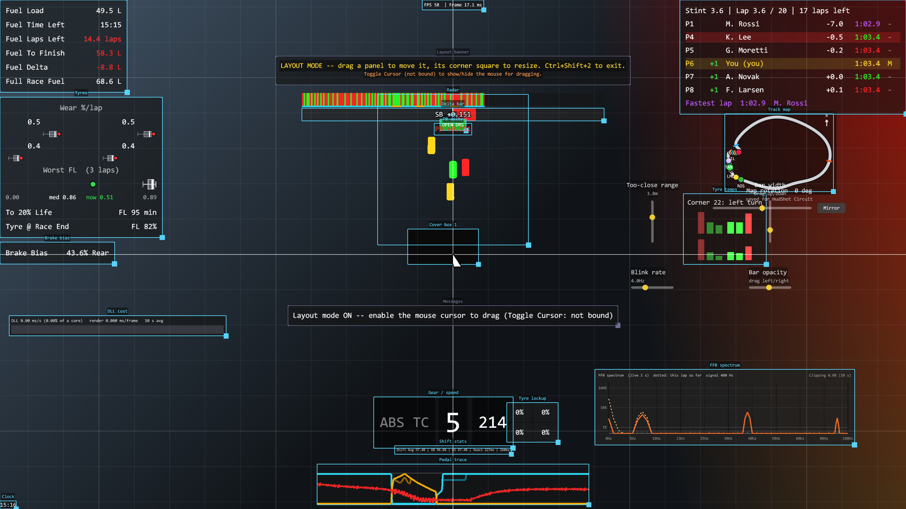

# rF2SkrOverlay

A free in-car HUD for rFactor 2, drawn straight into the game: no extra windows, nothing to alt-tab to.

- Radar with side proximity bars
- Gear, speed and shift light, with ABS/TC and tyre lockup indicators
- Pedal trace
- Lap delta bar and mini-sector strip
- Relative timing
- Fuel, tyre wear and brake bias
- Tyre temperatures, track map and FFB spectrum
- Stint targets: a fuel-saving bar and a tyre-wear target panel
- Water/oil temperatures and FFB strength with clipping
- Track conditions for mixed weather: slicks/wets call, wetness and rain trends, game and real-world forecasts
- Optional braking-point beep from your best lap, with a reaction-time readout (off by default)

Every panel can be dragged, resized and switched on or off in game (Ctrl+Shift+2 for layout mode), and the
layout is remembered for each car. Works on Linux/Proton too, with a built-in font.

*Both pictures are drawn by the real plugin from simulated race data. A short video of resizing a panel is
attached to each release.*

## Why it exists

Most overlays (SimHub dashboards, Discord, Afterburner's OSD, many HUD apps) are a separate transparent window on
top of the game. Any window over the game, even an invisible click-through one, forces Windows to send every frame
through the desktop compositor (*Composed Flip*) instead of straight to the display (*Independent Flip*). That
adds latency and takes the direct hand-off away from G-Sync/FreeSync, which is why transparent overlays get blamed
for stutter and input lag.

rF2SkrOverlay has no window. It hooks rFactor 2's own DirectX 11 output and draws the HUD into each frame before the
game hands it to Windows, so the game keeps the direct path to your monitor. The guide explains this in more detail.

## Download and install

Get the latest zip from [Releases](../../releases), then drop `rF2SkrOverlayPublic.dll` into
`rFactor 2\Bin64\Plugins`. The full guide, `rF2SkrOverlayPublic_Guide.html`, is in the zip and in this repository.

## Building

Run `build.bat` (needs the Visual Studio C++ build tools; see the guide's licence section).

## Licence

GPL-3, see [LICENSE.html](LICENSE.html). The built-in DejaVu Sans Mono font is under its own free licence, see
[FONT-LICENSE.html](FONT-LICENSE.html). `InternalsPlugin.hpp` and `PluginObjects.hpp` are Image Space
Incorporated's rFactor 2 plugin SDK headers and remain under ISI's terms.

Thanks to [TinyPedal](https://github.com/TinyPedal/TinyPedal) and [CrewChief](https://gitlab.com/mr_belowski/CrewChiefV4),
both open source (GPL-3 and MIT), whose source code was consulted, and to the SRGP community
for testing.

By Paul Kiernan, Shamrock Kiernan Racing (SKR).
